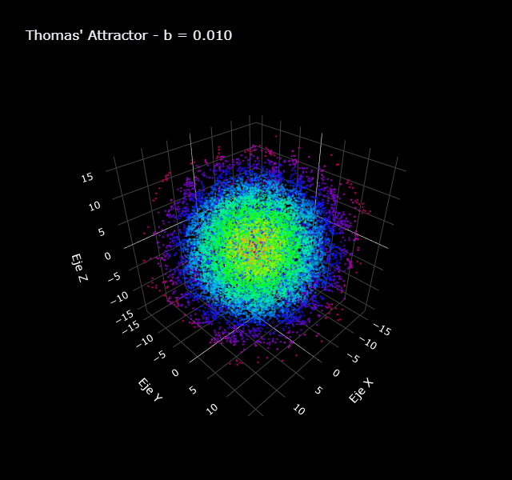
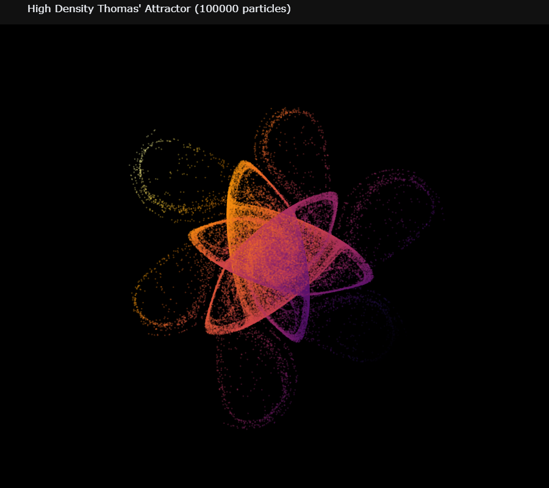
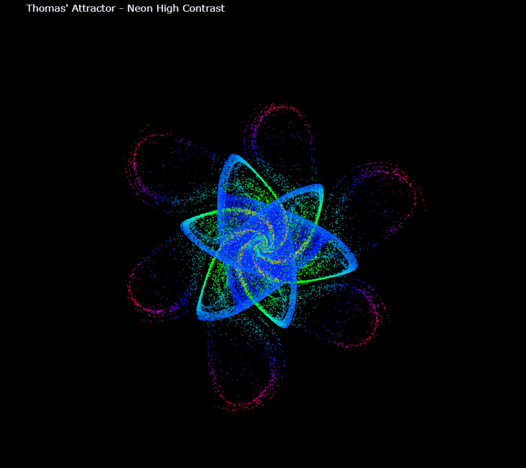

# Sistemas Dinámicos y Caos

Trabajos de la asignatura **Sistemas Dinámicos y Caos** (2025-2), desarrollados en Google Colab con Python (numpy, scipy, matplotlib).

**Autora:** Natalia Isabel Martinez
**Colaborador:** Esteban Gómez

## ⭐ Trabajo final: atractor de Thomas

Carpeta [`01_Trabajo_Final_Atractor_de_Thomas/`](01_Trabajo_Final_Atractor_de_Thomas)

Sistema caótico de Thomas:

$$\dot{x} = \sin y - b\,x,\qquad \dot{y} = \sin z - b\,y,\qquad \dot{z} = \sin x - b\,z$$

  
   <em>Evolución del atractor al variar el parámetro b de 0.01 a 0.30</em>

  
  

> Las figuras 3D del notebook son interactivas (Plotly) y GitHub no puede mostrarlas, así que en el notebook se ven como imágenes fijas. Para girarlas y usar el deslizador de *b*, ábrelo con el botón **Abrir en Colab**.

| Archivo | Contenido |
|---|---|
| `Atractor_de_Thomas.ipynb` | Integración con Runge-Kutta de orden 4 (RK4), visualización 3D del atractor, animaciones y cálculo de los puntos fijos al resolver $b\,r = \sin r$. |
| `imagenes/` | Imágenes fijas de las figuras 3D de Plotly y el GIF de la animación. |
| `Puntos_Fijos_GeoGebra_v1.ggb`, `_v2.ggb` | Construcción en GeoGebra de la intersección de $y = \sin x$ y $y = b\,x$, que muestra cómo cambian los puntos fijos con el parámetro $b$. |

## Talleres

Carpeta [`02_Talleres/`](02_Talleres)

| Archivo | Contenido |
|---|---|
| `Taller2_Graficas.ipynb`  | Gráficas de los talleres de flujos en el círculo, sistemas lineales y planos de fase (ejercicios de Strogatz, capítulos 4 a 8): péndulo amortiguado, sistema excitable, diagrama traza-determinante, oscilador amortiguado, modelos de "amor" de Romeo y Julieta, variedades estables e inestables, Van der Pol, competencia de especies, sistemas conservativos, ciclos límite en polares, sistemas de Liénard, modelo de Tyson, Brusselator, osciladores acoplados en el toro y curvas de bifurcación. |
| `Graficas_Talleres_Bifurcaciones.ipynb`  | Gráficas de los talleres: modelo de Gompertz, potenciales $V(x)$, error del método de Euler vs $\Delta t$, campos vectoriales 1D y diagramas de bifurcación (silla-nodo, transcrítica, tridente), por ejemplo para $\dot x = r x - \frac{x}{1+x}$, $\dot x = x + \tanh(r x)$ y $\dot x = r x + a x^2 - x^3$. |

## Cómo ejecutarlos

- Notebooks: ábrelos en [Google Colab](https://colab.research.google.com/) (Archivo → Subir notebook).
- Archivos `.ggb`: ábrelos en [GeoGebra](https://www.geogebra.org/calculator) (Menú → Abrir).
